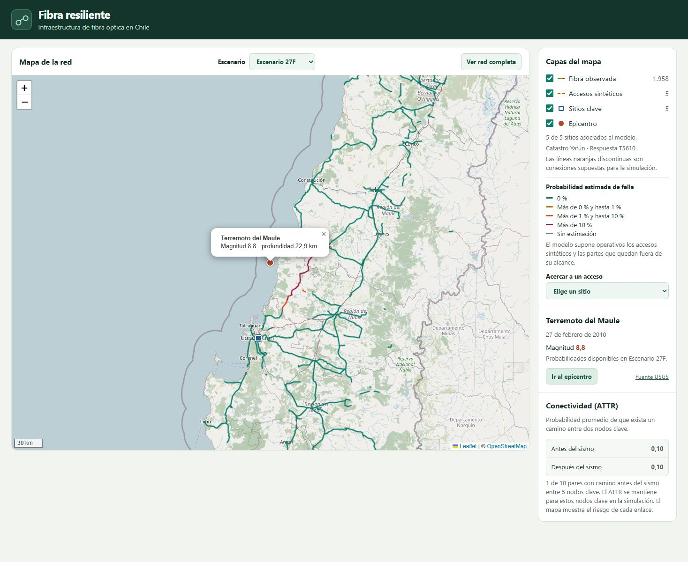

# fibra-resiliente

T2 de ruteo. Simulación del terremoto del Maule sobre la red de fibra del catastro Yafún.

## Cómo correrlo

Con Python 3.10 o superior y Docker Desktop abierto en modo de contenedores Linux, ejecuta esto en la carpeta del repo.

```powershell
python main.py
```

[`main.py`](main.py) prepara `.env` si hace falta, levanta PostgreSQL y ejecuta [`main.sql`](main.sql). Desde una base vacía, el SQL importa el shapefile, crea la topología, carga los cinco sitios y el sismo, guarda las probabilidades por enlace y calcula ambos ATTR. Python exporta el GeoJSON y abre Leaflet. Puedes repetir el comando para recalcular el escenario con la misma topología.

Python usa la biblioteca estándar. Docker Compose levanta PostgreSQL 17 con PostGIS 3.5 y pgRouting 3.7.3. La imagen instala `shp2pgsql` para importar el catastro. El visor usa Leaflet 1.9.4 desde CDN y teselas de OpenStreetMap.

La consola muestra la URL del visor. Si el puerto 8000 está ocupado se usa otro. Con `Ctrl+C` cierras el visor y con `docker compose down` detienes la base. Los datos se guardan en el volumen de Docker.


## Datos y topología

El shapefile `fibra_optica_detectada` de la respuesta SAIP T5610 trae **1.915 trazados**. Los enlaces observados del grafo suman **10.312,76 km**, medidos con PostGIS sobre `geography`. Los cerca de **28.000 km** que publica Yafún corresponden a recorridos documentados e incluyen caminos con distintas infraestructuras. Los huecos del mapa reflejan la cobertura parcial del catastro, especialmente en redes urbanas y de última milla. [Informe Yafún, pp. 22–24](https://www.nic.cl/estudios/resiliencia_uchile_corfo_subtel.pdf#page=24) · [Recorrido Yafún](https://yafun.nic.cl/mapas/recorrido-yafun/)

Las capas `postacion_electrica_detectada`, `camino_sin_postacion_detectado` y `trayecto_en_ferry` se conservan como referencia. La postación identifica recorridos con postes eléctricos y sirve para estudiar dónde se podría tender fibra. `main.sql` carga la capa de fibra detectada para representar los tendidos observados. El escenario de falla usa el supuesto de fibra enterrada y deja fuera la caída de postes como mecanismo de daño.

[`crear_topologia.sql`](sql/crear_topologia.sql) agrupa con PostGIS los extremos separados por hasta 1 cm y corta un trazado donde coincide el extremo de otro con su interior. A 1 cm se detectaron 140 pares de extremo e interior sin coincidencia exacta. Se registran como posibles uniones para revisión y quedan fuera de las conexiones del grafo. Luego se ejecuta esta llamada con tolerancia cero porque los extremos agrupados ya tienen coordenadas iguales.

```sql
SELECT pgr_createTopology('public.fibra_enlaces', 0, 'geom', 'id', 'source', 'target');
```

En la prueba de 1 cm, pgRouting reportó `TOPOLOGY CREATED FOR 1958 edges` y `Rows with NULL geometry or NULL id: 0`.

La comparación usó los mismos trazados y la misma regla de corte. Se eligió 1 cm porque dio el mismo número de vértices y componentes que 10 cm, con un margen menor para unir extremos.

| Tolerancia entre extremos | Enlaces | Vértices | Componentes | Mayor componente (vértices) |
| --- | ---: | ---: | ---: | ---: |
| Coincidencia exacta | 1.958 | 2.386 | 437 | 59 |
| **1 cm** | **1.958** | **2.080** | **138** | **223** |
| 10 cm | 1.958 | 2.080 | 138 | 223 |
| 1 m | 1.958 | 2.079 | 137 | 223 |

`fibra_enlaces` guarda `source`, `target` y `prob_falla`, que parte en `0`. `fibra_enlaces_vertices_pgr` guarda los 2.080 vértices de la red observada. Esta es una muestra de esa tabla con los puntos que reciben los accesos de los sitios clave.

| `id` | `the_geom` (longitud, latitud) |
| ---: | --- |
| 463 | `POINT(-72.953981 -41.470603)` |
| 501 | `POINT(-73.050317 -36.827014)` |
| 505 | `POINT(-70.700582 -33.366189)` |
| 570 | `POINT(-71.628351 -33.038316)` |

## Nodos clave

Se eligieron cinco sitios que procesan, intercambian, transportan o reciben tráfico. La tabla muestra las coordenadas de cada instalación o del punto de referencia documentado.

| Sitio (latitud, longitud) | Rol | Terminal → vértice | Acceso (m) | Fuentes |
| --- | --- | --- | ---: | --- |
| Google PARAM, Quilicura (−33,35830 · −70,69646) | Centro de datos que procesa y entrega servicios | 2081 → 505 | 955,5 | [Google](https://datacenters.google/intl/es-419/locations/quilicura-chile/) · [SEA](https://infofirma.sea.gob.cl/DocumentosSEA/MostrarDocumento?docId=41%2Fb2%2Fcb84bb5d771c27e818fe1ad882ad0c553bb9) |
| PIT Chile en Cirion SAN1, Huechuraba (−33,35799 · −70,67626) | Intercambio de tráfico entre redes | 2082 → 505 | 2.439,4 | [PIT Chile](https://www.pitchile.cl/wp/como-conectarse/) · [PeeringDB](https://www.peeringdb.com/fac/2093) |
| Estación SAm-1, Valparaíso (−33,02253 · −71,64150) | Conexión internacional por cable submarino | 2083 → 570 | 2.138,9 | [Concesión](https://www.bcn.cl/leychile/Navegar/imprimir?idNorma=174525&idVersion=2000-08-21) · [Plano de Telxius](https://fcc.report/IBFS/SCL-MOD-20180905-00032/1982583.pdf#page=3) |
| REUNA, Puerto Montt (−41,49414 · −72,98721) | Punto de presencia de la red troncal académica | 2084 → 463 | 3.812,6 | [REUNA](https://www.reuna.cl/wp-content/uploads/dlm_uploads/2025/06/Memoria-REUNA-2024.pdf#page=22) · [Extracto SUBTEL](https://legales.cooperativa.cl/wp-content/uploads/2021/10/VERSI%C3%93N-IMPRESA-EXTRACTO-21-SP57893-RED-UNIVERSITARIA-NACIONAL.pdf) |
| UdeC, campus Concepción (−36,82939 · −73,03621) | Recepción de conectividad académica | 2085 → 501 | 1.285,8 | [UdeC](https://vraeaweb.udec.cl/dti/educacion-tecnologica/) · [Extracto SUBTEL](https://legales.cooperativa.cl/wp-content/uploads/2021/10/VERSI%C3%93N-IMPRESA-EXTRACTO-21-SP57893-RED-UNIVERSITARIA-NACIONAL.pdf) |

El catastro guarda los trazados detectados. Para representar cómo podría llegar cada sitio a esa fibra se creó un acceso supuesto al vértice más cercano. La longitud de la tabla es la distancia geodésica en línea recta. Cada sitio conserva su terminal propio. La vista `fibra_enlaces_modelo` reúne los 1.958 enlaces observados y los cinco accesos marcados con `es_sintetico`. Las referencias de ubicación están detalladas en [`incorporar_nodos_clave.sql`](sql/incorporar_nodos_clave.sql).

## Sismo del 27F

[`red/sismo_27f.geojson`](red/sismo_27f.geojson) contiene la respuesta de USGS. [`importar_sismo.sql`](sql/importar_sismo.sql) guarda el epicentro como punto WGS84 y la profundidad en una columna aparte. [Consulta original de USGS](https://earthquake.usgs.gov/fdsnws/event/1/query?format=geojson&starttime=2010-02-27T06:30:00&endtime=2010-02-27T06:40:00&minmagnitude=8.8&limit=1)

| `sismos.id_usgs` | Fecha UTC | Magnitud | Epicentro (longitud, latitud) | Profundidad |
| --- | --- | ---: | --- | ---: |
| `official20100227063411530_30` | 2010-02-27 06:34:11.530 | 8,8 | `POINT(-72.898 -36.122)` | 22,9 km |

## Modelo de falla

[`calcular_fallas_27f.sql`](sql/calcular_fallas_27f.sql) divide cada enlace en porciones de hasta 10 km. `ST_Distance` sobre `geography` devuelve en metros la distancia desde el punto medio de cada porción al epicentro. Se convierte esa distancia a kilómetros (`d`) y se combina con la profundidad `h`. Así se obtiene `R = sqrt(d² + h²)`, que aproxima la distancia a la ruptura. La ecuación de Montalva estima la aceleración del suelo para un sismo de interfaz del lado de la fosa. [Artículo de Montalva et al. (2017) en BSSA](https://pubs.geoscienceworld.org/ssa/bssa/article-abstract/107/2/901/354169/Ground-Motion-Prediction-Equation-for-the-Chilean?redirectedFrom=fulltext)

Para `M = 8,8` se usa la rama de magnitud alta. Los coeficientes son los de PGA y `Vs30 = 500 m/s` es el valor que ilustra el suplemento para el Maule. Se usa el mismo valor de suelo en toda la red. [Suplemento de Montalva et al., figura S1](https://www.seismosoc.org/Publications/BSSA_html/bssa_107-2/2016221-esupp/) · [Coeficientes de PGA](https://docs.openquake.org/oq-engine/3.6/_modules/openquake/hazardlib/gsim/montalva_2017.html)

```text
C1 = 7.2, ΔC1 = 0.2, θ4 = 0.80276784, θ5 = −0.33486952
θ1 = 5.87504394, θ2 = −1.75359772, θ3 = 0.13125248, θ6 = −0.00039095
θ12 = 1.01494528, Vlin = 865.1 m/s, b = −1.186, c = 1.88, n = 1.18

A = θ1 + θ4 ΔC1 + θ5 (M − C1 − ΔC1)
    + (θ2 + θ3 (M − C1)) ln(R + 10 exp(0.4 (M − 6))) + θ6 R
r = Vs30 / Vlin
PGA_roca = exp(A + (θ12 + b n) ln(1000 / Vlin))
PGA = exp(A + θ12 ln(r) − b ln(PGA_roca + c) + b ln(PGA_roca + c r^n))
```

Con la `PGA` en unidades de `g`, se aplica la ecuación 5 del caso REUNA, tomada de Saygili y Rathje. `x = kc / PGA` y `L` es el largo en kilómetros de cada porción.

```text
PGD = exp(5.52 − 4.43 x − 20.39 x² + 42.61 x³ − 28.74 x⁴ + 0.72 ln(PGA)) / 100
FR = max(0, α × (4.317 × PGD − 0.324))
p_falla = 1 − exp(−Σ(L × FR))
```

`PGD` es el desplazamiento del suelo. El `/ 100` lo convierte de centímetros a metros. Con `PGA ≤ kc` se toma `PGD = 0`. Se usan `kc = 0,1 g` como aceleración crítica y `α = 0,26` como factor de fibra enterrada robusta, ambos del caso REUNA descrito en la sección IV-A. Las ecuaciones 3–6 están en la **sección III-C, «Links Risk Assessment», p. 31346** de Jiménez, Barrera y Cancela (2023). Ahí se obtiene la tasa por kilómetro (`FR`) y la probabilidad de falla del enlace completo, ponderando cada porción por su largo. [Artículo en IEEE Access](https://ieeexplore.ieee.org/document/10065481/) · [Texto completo en ResearchGate](https://www.researchgate.net/publication/369150750_Communication_Network_Reliability_under_geographically_correlated_failures_using_Probabilistic_Seismic_Hazard_Analysis#:~:text=LINKS%20RISK%20ASSESSMENT)

La instalación enterrada se usa como supuesto para estos trazados. También se mantienen operativos los accesos sintéticos y las porciones a más de 1.000 km del epicentro, el límite de aplicación de la atenuación que cita el estudio. La fuente puntual aproxima una ruptura extensa y puede omitir sacudida a lo largo de ella. [Jiménez, Barrera y Cancela (2023), sección III-A](https://www.researchgate.net/publication/369150750_Communication_Network_Reliability_under_geographically_correlated_failures_using_Probabilistic_Seismic_Hazard_Analysis#:~:text=up%20to%201000%20km)

## Probabilidades por enlace

El cálculo actualiza `fibra_enlaces.prob_falla` y guarda la distancia epicentral mínima, la PGA máxima y la cobertura en `fallas_27f`. De los 1.958 enlaces observados, **21** tienen probabilidad positiva, 1.531 tienen probabilidad cero con cobertura completa, 405 quedan fuera de alcance y uno tiene cobertura parcial. Leaflet dibuja en gris los enlaces fuera de alcance.

| Enlace | Distancia mínima al epicentro (km) | Probabilidad de falla | Resultado |
| ---: | ---: | ---: | --- |
| 254 | 37,09 | 55,56 % | Mayor probabilidad |
| 253 | 33,26 | 54,73 % | Segunda mayor |
| 252 | 39,44 | 39,41 % | Tercera mayor |
| 1575 | 44,13 | 1,15 % | Menor probabilidad positiva |
| 277 | 46,92 | 0,00 % | Cero dentro del alcance |
| 169 | 48,64 | 0,00 % | Cero dentro del alcance |

El 55,56 % del enlace 254 es la probabilidad estimada de que falle ese enlace completo. La tabla muestra la distancia mínima al epicentro. El cálculo usa el punto medio y el largo de cada porción, de modo que una distancia mínima menor puede dar una probabilidad menor.

## ATTR antes y después

El ATTR es `Σ P(el par tiene camino) / cantidad de pares`. Con cinco sitios se forman diez pares distintos. [`calcular_attr.sql`](sql/calcular_attr.sql) usa `pgr_connectedComponents` con todos los enlaces operativos. [`calcular_attr_posterior.sql`](sql/calcular_attr_posterior.sql) usa las probabilidades registradas en la base. Calcula un mínimo conservando solo enlaces con `p_falla = 0` y un máximo conservando todos los que tienen `p_falla < 1`. Quitar enlaces solo puede reducir la conectividad. Si ambos extremos coinciden, el resultado es exacto. Si difieren, se hacen 1.000 ensayos con semilla fija y fallas independientes. Para ese tamaño de muestra, el error estándar de una media entre cero y uno es como máximo 0,016. [Boettcher et al. (2018)](https://doi.org/10.1109/TLA.2018.8789553)

| Resultado de la ejecución | Nodos clave | Pares totales | Pares con camino | ATTR |
| --- | ---: | ---: | ---: | ---: |
| Antes del sismo | 5 | 10 | 1 | 0,10 |
| Después del sismo | 5 | 10 | 1 (exacto) | 0,10 |

Google–PIT es el único par conectado. El camino `Google 2081 → 505 → PIT 2082` usa los dos accesos sintéticos que el escenario mantiene operativos. SAm-1, REUNA Puerto Montt y UdeC están cada uno en una componente distinta de todos los demás sitios clave desde el inicio. Los 21 enlaces con riesgo positivo quedan fuera del único camino entre terminales y los nueve pares desconectados siguen así. Por eso el escenario mantiene las conexiones entre sitios clave. La diferencia es **0 puntos porcentuales** y la variación relativa es **0 %**.

### Comparación con el 27F de 2010

En 2010 ya había fibra óptica instalada en Chile. Tras el 27F, ASCE/TCLEE documentó cortes en tendidos, principalmente junto a puentes y pasos elevados. Enlaces alternativos permitieron que algunos circuitos siguieran funcionando. NIC Chile reportó que su servicio web se vio afectado por problemas de conectividad entre las 04:04 y las 09:14 del 27 de febrero, mientras la redundancia sostuvo el DNS de `.CL`. [Informe de campo ASCE/TCLEE, pp. 8–9](https://lfestorage.s3.us-east-2.amazonaws.com/images/2010_02_27_chile/pdfs/TCLEE-Web-Report-EERI-v1.pdf#page=8) · [Comunicado de NIC Chile](https://www.nic.cl/anuncios/20100301-terremoto.html)

El mapa de fibra que usamos viene de Yafún, cuyo levantamiento comenzó en 2016. «Antes» y «después» comparan esa misma red primero con todos sus enlaces operativos y luego sometida a un sismo con los parámetros del 27F. El ATTR se mantiene porque el camino Google–PIT conserva sus dos accesos supuestos. El modelo evalúa caminos de fibra entre cinco sitios y deja fuera mecanismos como la caída de puentes y el corte de suministro eléctrico. [Universidad de Chile, levantamiento Yafún](https://uchile.cl/noticias/153597/yafun-proyectando-robustez-para-las-redes-digitales-chilenas)

## Visor Leaflet

En **Escenario 27F**, los enlaces observados se colorean por probabilidad de falla. Los accesos sintéticos quedan en naranja discontinuo, los sitios clave en azul y el epicentro en rojo. Al hacer clic en un enlace se puede revisar su probabilidad y el alcance del cálculo. El panel muestra los dos ATTR en la misma vista.



## Comandos de apoyo

- `docker compose exec db psql -U fibra -d fibra` abre la consola de PostgreSQL. La conexión desde el host usa `127.0.0.1:5433`.
- `./comparar_tolerancias.ps1` compara los cuatro umbrales sobre la misma fibra y descarta cada prueba al terminar.
- `./exportar_mapa.ps1` regenera el GeoJSON a partir de la base.
- `python -m http.server 8000 --bind 127.0.0.1 --directory frontend` sirve el mapa ya exportado.
